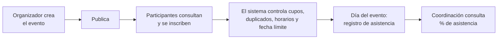
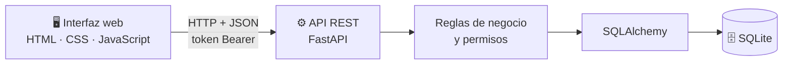
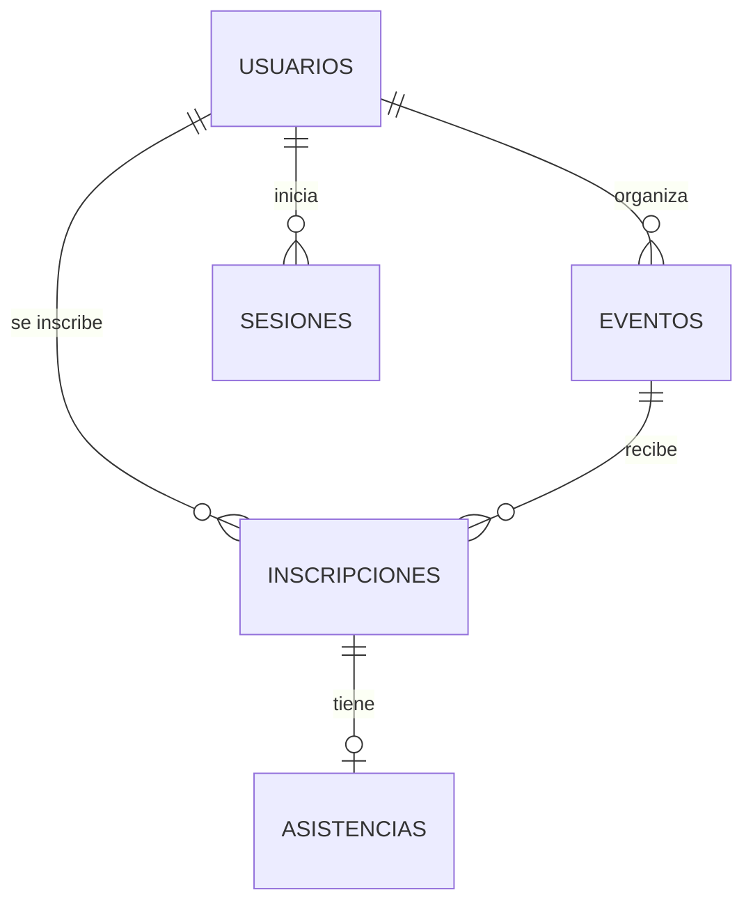
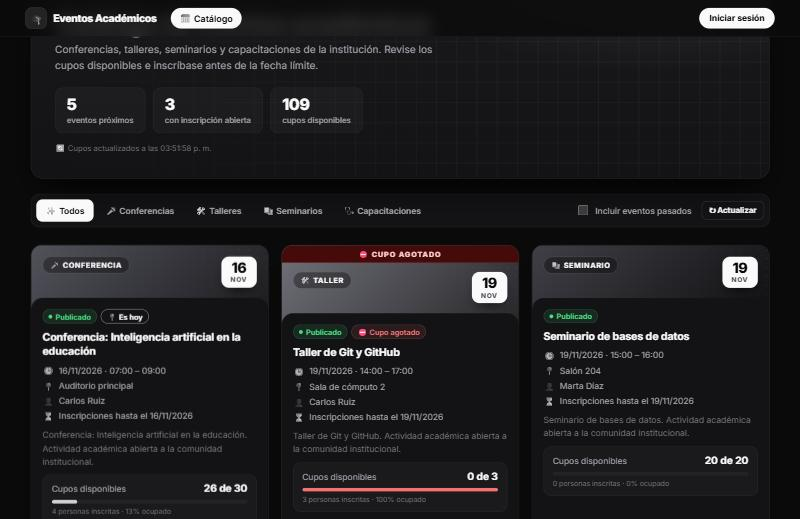
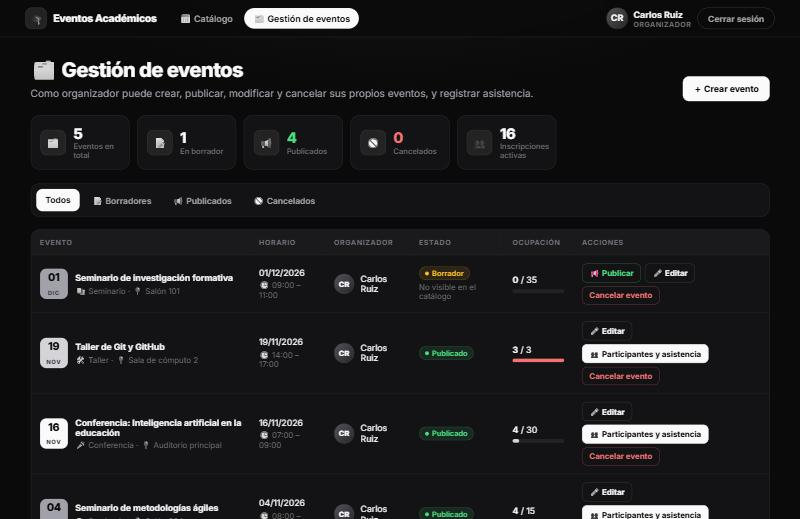
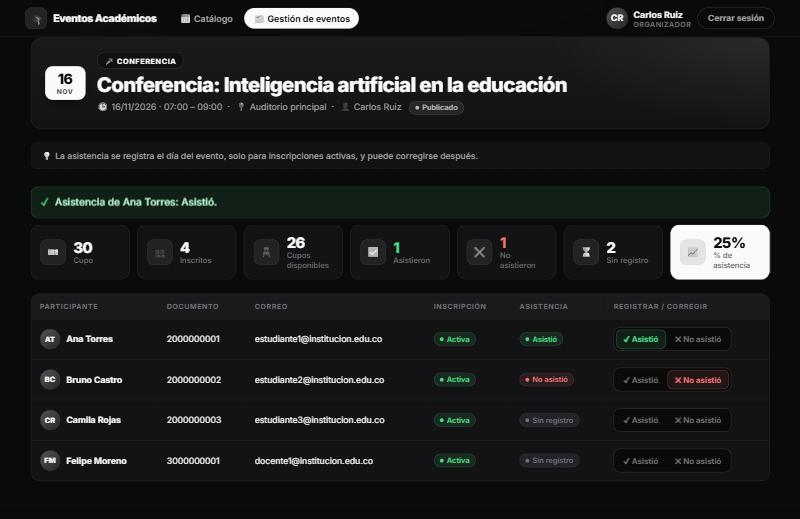
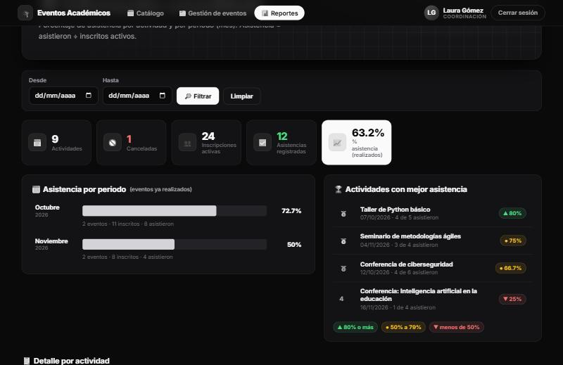

# 🎓 Eventos Académicos — Organización de eventos y actividades académicas

Aplicación web para crear y publicar actividades académicas, consultar el catálogo, inscribir participantes con control de cupos y registrar la asistencia, con información consolidada para la coordinación.

---

## 1. Información general

| Campo | Valor |
|---|---|
| Proyecto | Proyecto Final PF-04 — Organización de eventos y actividades académicas |
| Grupo | 14 |
| Asignatura | Aplicaciones y Servicios Web — Tecnología en Desarrollo de Software |
| Docente | Juan Carlos Morales Guerra |
| Fecha de entrega | 18 de noviembre de 2026 |
| Repositorio | https://github.com/julianm17297/eventos-academicos |

### Integrantes y contribución

| Integrante | Usuario GitHub | Contribución principal | Pull requests |
|---|---|---|---|
| Julian Monsalve | [@julianm17297](https://github.com/julianm17297) | Requisitos, base del backend (modelo de datos, seguridad y login), reglas de inscripción y cupos, interfaz del participante, pruebas funcionales | #1, #3, #5, #7, #9 |
| Daniel Calle | [@DanielCalle00](https://github.com/DanielCalle00) | Diseño (arquitectura, modelo, API), servicios de eventos, asistencia y reportes, interfaz de organizador y coordinación, trazabilidad y documentación final | #2, #4, #6, #8, #10 |

Cada pull request fue revisado y aprobado por el otro integrante antes de integrarse a `main`.

---

## 2. Descripción del sistema

**Problema.** La institución anuncia sus actividades por distintos medios y recibe inscripciones por formularios y mensajes separados. No conoce el número real de inscritos, no controla los cupos, recibe registros duplicados y le cuesta consolidar la asistencia.

**Actores.** Participante (estudiantes, docentes y demás personas de la institución), Organizador y Coordinación.

**Solución.** Una aplicación web con interfaz, API REST y base de datos relacional que cubre todo el proceso:



**Alcance aprobado:** creación y publicación de actividades, catálogo con disponibilidad, inscripción y cancelación, control de cupos y reglas, registro y corrección de asistencia, reportes por actividad y por mes, inicio de sesión con roles. No incluye pagos, videoconferencias, mensajería, certificados, QR, lista de espera ni integración con otros sistemas.

📄 Detalle completo: [docs/requisitos.md](docs/requisitos.md)

---

## 3. Requisitos y alcance

- **Método:** entrevista estructurada con el docente en el rol de representante de la organización (3 preguntas con subpreguntas). El registro de preguntas, respuestas y decisiones está en [docs/requisitos.md §2](docs/requisitos.md#2-registro-de-la-entrevista).
- **Decisiones confirmadas por el representante:**
  - Solo personas de la institución pueden inscribirse.
  - La coordinación puede consultar, modificar y cancelar eventos.
  - La publicación no requiere autorización.
  - Hay fecha límite de inscripción y el participante puede cancelar.
  - El cupo es un límite: si se agota, la inscripción se rechaza.
  - No se permite estar en dos actividades con el mismo horario.
  - La asistencia se registra el día del evento, por actividad, como *Asistió* / *No asistió*, y puede corregirse.
  - No se registra asistencia a quien no esté inscrito.
  - La coordinación necesita el porcentaje de asistencia por actividad y por periodos.
- **Requisitos:** 15 funcionales (RF-01 a RF-15), 7 no funcionales (RNF-01 a RNF-07), 16 reglas de negocio y 7 historias de usuario con criterios de aceptación ([docs/requisitos.md](docs/requisitos.md)).
- **Decisiones complementarias:** D-01 a D-07 (por ejemplo, que cancelar libera el cupo o que el periodo de los reportes es el mes), aprobadas por el docente en la revisión del alcance; ver [docs/requisitos.md](docs/requisitos.md#acuerdos-y-decisiones-aprobadas).

| Prioridad | Requisitos | Historias de usuario | Condiciones |
|---|---|---|---|
| Imprescindible | RF-01 a RF-14 | HU-01 a HU-07 | CA-01 a CA-06 |
| Importante | RF-15 (cancelar eventos) | HU-01 | CA-01 |
| Fuera de alcance | Pagos, videoconferencia, mensajería, certificados, QR, lista de espera, integración con otros sistemas | — | — |

---

## 4. Arquitectura, diseño de API y modelo de datos





| Tecnología | Uso | Justificación |
|---|---|---|
| Python + FastAPI | Backend y API REST | Validación automática y documentación interactiva en `/docs` |
| SQLAlchemy + SQLite | Persistencia relacional | Llaves, relaciones y restricciones sin instalar un servidor de BD |
| HTML + CSS + JavaScript | Frontend | Sin compilación; consume la API con `fetch` |

📄 Arquitectura completa, modelo de datos, estados, flujo de reglas, permisos y especificación de la API: [docs/diseno.md](docs/diseno.md)

### Capturas de la interfaz

| Catálogo | Gestión de eventos |
|---|---|
|  |  |
| **Asistencia** | **Reportes de coordinación** |
|  |  |

---

## 5. Configuración del entorno

**Requisitos:** Python 3.10 o superior y Git. No requiere Docker, Node.js ni instalar un motor de base de datos.

```bash
git clone https://github.com/julianm17297/eventos-academicos.git
cd eventos-academicos
python -m venv .venv
```

Activar el entorno virtual:

```bash
# Windows (PowerShell)
.venv\Scripts\Activate.ps1
# macOS / Linux
source .venv/bin/activate
```

Instalar dependencias:

```bash
pip install -r requirements.txt
```

**Variables de entorno (opcional):** copiar `.env.example` como `backend/.env`. Si no existe, se usan los valores por defecto. El archivo `.env` nunca se sube al repositorio.

**Preparar la base de datos y ejecutar:**

```bash
cd backend
python -m app.seed                          # crea la base eventos.db con datos ficticios
python -m uvicorn app.main:app --reload     # inicia frontend + API
```

| Dirección | Contenido |
|---|---|
| http://127.0.0.1:8000 | Interfaz web |
| http://127.0.0.1:8000/docs | Documentación interactiva de la API |

**Datos de prueba (ficticios).** Todas las cuentas usan la contraseña `Clave123*`:
`coordinacion@institucion.edu.co` (Coordinación), `organizador1@institucion.edu.co` y `organizador2@institucion.edu.co` (Organizadores), `estudiante1@` a `estudiante5@institucion.edu.co` y `docente1@institucion.edu.co` (Participantes). Las fechas de los eventos de ejemplo se calculan desde el día actual, así que siempre hay un evento **hoy** para registrar asistencia. Para volver al estado inicial, ejecute de nuevo `python -m app.seed`.

---

## 6. Servicios web implementados

| Método | Ruta | Descripción | Requisito relacionado |
|---|---|---|---|
| POST | `/api/auth/registro` | Crear cuenta de participante (correo institucional) | RF-01 |
| POST | `/api/auth/login` | Iniciar sesión y obtener token | RF-02 |
| POST | `/api/auth/logout` | Cerrar sesión | RF-02 |
| GET | `/api/auth/yo` | Usuario de la sesión actual | RF-02 |
| GET | `/api/eventos` | Catálogo de eventos publicados con cupos | RF-05 |
| GET | `/api/eventos/{id}` | Detalle de un evento | RF-05 |
| GET | `/api/gestion/eventos` | Eventos a gestionar (propios o todos según rol) | RF-03 |
| POST | `/api/eventos` | Crear evento (Borrador) | RF-03 |
| PUT | `/api/eventos/{id}` | Modificar evento | RF-03 |
| PATCH | `/api/eventos/{id}/publicar` | Publicar evento | RF-04 |
| PATCH | `/api/eventos/{id}/cancelar` | Cancelar evento | RF-15 |
| POST | `/api/eventos/{id}/inscripciones` | Inscribirse | RF-06, RF-08, RF-09, RF-10 |
| GET | `/api/inscripciones/mias` | Mis inscripciones y asistencia | RF-07 |
| PATCH | `/api/inscripciones/{id}/cancelar` | Cancelar inscripción (libera cupo) | RF-07 |
| GET | `/api/eventos/{id}/participantes` | Lista de inscritos con asistencia | RF-12 |
| PUT | `/api/eventos/{id}/asistencia/{inscripcion_id}` | Registrar o corregir asistencia | RF-11, RF-12 |
| GET | `/api/reportes/eventos` | % de asistencia por actividad | RF-13 |
| GET | `/api/reportes/periodos` | % de asistencia por mes | RF-14 |

**Ejemplo — inscripción rechazada por cupo agotado**

```http
POST /api/eventos/2/inscripciones
Authorization: Bearer <token de estudiante4>
```

```json
HTTP/1.1 409 Conflict
{ "detail": "El cupo del evento está agotado." }
```

**Ejemplo — datos inválidos**

```json
HTTP/1.1 422 Unprocessable Entity
{ "detail": "Datos inválidos",
  "errores": ["titulo: String should have at least 3 characters", "cupo: Input should be greater than 0"] }
```

Códigos usados: 200, 201, 204, 400, 401, 403, 404, 409, 422 (ver [docs/diseno.md §6](docs/diseno.md#6-especificación-de-la-api-rest)). Documentación interactiva completa en `/docs`.

---

## 7. Pruebas de API e integración

Pruebas funcionales documentadas: las 12 mínimas de la guía (PF-01 a PF-12), 8 adicionales para las reglas aprobadas (PF-13 a PF-20) y 8 desde la interfaz (IU-01 a IU-08). **Resultado: 28 de 28 aprobadas.**

| ID | Prueba | Requisito | Método y ruta principal | Código esperado y obtenido | Estado |
|---|---|---|---|---|---|
| PF-01 | Registro y publicación de actividad válida | RF-03, RF-04 / CA-01 | `POST /api/eventos` → `PATCH /api/eventos/{id}/publicar` | 201 → 200, visible en el catálogo | ✅ |
| PF-02 | Creación con datos inválidos | RF-03, RNF-02 | `POST /api/eventos` | 422 / 400, nada se guarda | ✅ |
| PF-03 | Consulta de catálogo y detalle | RF-05 / CA-02 | `GET /api/eventos`, `GET /api/eventos/{id}` | 200, cupos coherentes | ✅ |
| PF-04 | Evento inexistente | RF-05, RNF-03 | `GET /api/eventos/99999` | 404 controlado | ✅ |
| PF-05 | Inscripción válida | RF-06, RF-07 / CA-03 | `POST /api/eventos/{id}/inscripciones` | 201, recuperable en «mis inscripciones» | ✅ |
| PF-06 | Inscripción con datos inválidos | RF-01, RF-06, RNF-02 | `POST /api/eventos/abc/inscripciones`, `POST /api/auth/registro` | 422 / 404 | ✅ |
| PF-07 | Cupo agotado | RF-08 / CA-04 | `POST /api/eventos/2/inscripciones` | 409, inscritos sin cambios | ✅ |
| PF-08 | Inscripción duplicada | RF-09 / CA-04 | `POST /api/eventos/1/inscripciones` | 409, una sola inscripción | ✅ |
| PF-09 | Acciones sin autorización | RF-02, RNF-01 | Varias | 401 sin sesión, 403 sin permiso | ✅ |
| PF-10 | Registro y consulta de asistencia | RF-11, RF-12 / CA-05 | `PUT /api/eventos/{id}/asistencia/{inscripcion_id}` | 201, visible en la lista | ✅ |
| PF-11 | Consolidado y consistencia | RF-13, RF-14 / CA-06 | `GET /api/reportes/eventos`, `GET /api/reportes/periodos` | 200, totales coherentes | ✅ |
| PF-12 | Integración completa | CA-01 a CA-06 | Crear → publicar → inscribir → asistencia → reporte | Todos los pasos correctos y verificados con SQL en la base | ✅ |
| PF-13 a PF-20 | Cruce de horario, fecha límite, cancelación, asistencia fuera de reglas, corrección, cupo menor a inscritos, coordinación, login | RF-02, RF-03, RF-07, RF-08, RF-10, RF-11, RF-12, RF-15 | Varias | 409, 403, 404, 422, 200 y 401 según el caso | ✅ |
| IU-01 a IU-08 | Menú por rol, crear y publicar, inscripción y cupo, rechazo visible, asistencia, reportes, acceso sin sesión, persistencia tras reiniciar | CA-01 a CA-06, RNF-01, RNF-04 | Interfaz web | Ver capturas | ✅ |

**Reproducir las pruebas** (con el servidor iniciado y la base recién reiniciada con `python -m app.seed`):

- **Documentación interactiva (`/docs`):** abrir `http://127.0.0.1:8000/docs`, ejecutar `POST /api/auth/login`, pulsar **Authorize** con el token y ejecutar cada endpoint con los datos de [docs/pruebas.md](docs/pruebas.md).
- **Script de apoyo:** desde la raíz, `python pruebas/ejecutar_pruebas.py` repite PF-01 a PF-20 y guarda cada solicitud y respuesta como evidencia.
- **Interfaz web:** seguir los pasos de IU-01 a IU-08 en [docs/pruebas.md §3](docs/pruebas.md#3-pruebas-de-integración-desde-la-interfaz).

Evidencias:

- 📄 Plan de pruebas con condiciones iniciales, pasos, datos, resultado esperado y obtenido: [docs/pruebas.md](docs/pruebas.md)
- 🧾 Cada solicitud y respuesta, más la consulta SQL directa a la base de datos: [evidencias/resultados_pruebas_api.md](evidencias/resultados_pruebas_api.md)
- 🖼️ Capturas del flujo completo y de casos inválidos: [evidencias/capturas/](evidencias/capturas/)
- 🔗 Matriz de trazabilidad: [docs/trazabilidad.md](docs/trazabilidad.md)

---

## 8. Control de versiones

- Flujo de trabajo: rama por funcionalidad (`feature/...`, `docs/...`) → pull request con propósito, cambios, pruebas y requisitos → revisión del otro integrante → *merge* a `main`.
- Pull requests: https://github.com/julianm17297/eventos-academicos/pulls?q=is%3Apr
- Historial de commits: https://github.com/julianm17297/eventos-academicos/commits/main
- Ramas: https://github.com/julianm17297/eventos-academicos/branches/all
- Aportes por integrante: https://github.com/julianm17297/eventos-academicos/graphs/contributors

| PR | Rama | Contenido | Autor | Revisor |
|---|---|---|---|---|
| [#1](https://github.com/julianm17297/eventos-academicos/pull/1) | `docs/requisitos-y-alcance` | Estructura inicial y requisitos | Julian Monsalve | Daniel Calle |
| [#2](https://github.com/julianm17297/eventos-academicos/pull/2) | `docs/diseno-arquitectura-y-api` | Arquitectura, modelo de datos y especificación de API | Daniel Calle | Julian Monsalve |
| [#3](https://github.com/julianm17297/eventos-academicos/pull/3) | `feature/base-datos-y-autenticacion` | Base de datos, modelo, seguridad, login y datos de ejemplo | Julian Monsalve | Daniel Calle |
| [#4](https://github.com/julianm17297/eventos-academicos/pull/4) | `feature/gestion-de-eventos` | Servicios de eventos (crear, publicar, modificar, cancelar, catálogo) | Daniel Calle | Julian Monsalve |
| [#5](https://github.com/julianm17297/eventos-academicos/pull/5) | `feature/inscripciones-y-cupos` | Inscripciones y reglas de cupos | Julian Monsalve | Daniel Calle |
| [#6](https://github.com/julianm17297/eventos-academicos/pull/6) | `feature/asistencia-y-reportes` | Asistencia y reportes consolidados | Daniel Calle | Julian Monsalve |
| [#7](https://github.com/julianm17297/eventos-academicos/pull/7) | `feature/interfaz-participante` | Interfaz: catálogo, acceso, mis inscripciones | Julian Monsalve | Daniel Calle |
| [#8](https://github.com/julianm17297/eventos-academicos/pull/8) | `feature/interfaz-gestion` | Interfaz: gestión, asistencia, reportes | Daniel Calle | Julian Monsalve |
| [#9](https://github.com/julianm17297/eventos-academicos/pull/9) | `test/pruebas-funcionales` | Pruebas funcionales y evidencias | Julian Monsalve | Daniel Calle |
| [#10](https://github.com/julianm17297/eventos-academicos/pull/10) | `docs/trazabilidad-y-readme` | Trazabilidad y README final | Daniel Calle | Julian Monsalve |

---

## 9. Conclusiones y limitaciones

**Cumplimiento.** Las seis condiciones obligatorias (CA-01 a CA-06) están implementadas de punta a punta (interfaz → API → base de datos) y verificadas con pruebas reproducibles.

**Dificultades y soluciones.**
- *Evitar inscripciones duplicadas incluso con solicitudes simultáneas:* además de la validación en la API, la base de datos tiene una restricción única `(evento, participante)`. Una persona que cancela y se vuelve a inscribir reutiliza su mismo registro.
- *Cupos siempre correctos:* los cupos disponibles no se guardan; se calculan a partir de las inscripciones activas.
- *Asistencia solo de inscritos:* la asistencia se relaciona con la inscripción, no con la persona, así que por diseño no se puede registrar a alguien no inscrito.
- *Porcentaje por periodo engañoso:* al principio los eventos futuros (sin asistencia) bajaban el porcentaje del mes. Ahora el reporte por periodo solo considera eventos ya realizados.
- *Demostración en cualquier fecha:* los datos de ejemplo calculan sus fechas desde el día actual.

**Limitaciones.** Sin lista de espera ni recuperación de contraseña (fuera del alcance acordado). Las cuentas de organizador y coordinación se crean con los datos iniciales. Cada evento ocurre en un solo día. SQLite es adecuado para el alcance del proyecto; para muchos usuarios simultáneos se recomendaría PostgreSQL, que solo requiere cambiar `DATABASE_URL`.

---

## 10. Registro de errores y correcciones

Una aplicación no queda perfecta en la primera versión. Durante el desarrollo, las pruebas y la subida a GitHub encontramos los siguientes errores. Para cada uno dejamos el síntoma, la causa que identificamos, la corrección aplicada y cómo comprobamos que quedó resuelto.

| ID | Error | Tipo | Corregido en |
|---|---|---|---|
| E-01 | Un evento publicado solo aparecía en el catálogo al marcar "Incluir eventos pasados" | Funcional (interfaz) | PR #7 |
| E-02 | Quien ocupaba el último cupo veía "Inscrito", pero no "Cupo agotado" | Funcional (interfaz) | PR #7 |
| E-03 | Rediseño de la interfaz a un estilo oscuro monocromático | Diseño / usabilidad | PR #7 y #8 |
| E-04 | El formulario de registro aparecía visible en la página de acceso | Interfaz (CSS) | PR #7 |
| E-05 | Algunas tarjetas del catálogo quedaban invisibles al cargar | Interfaz (CSS) | PR #7 |
| E-06 | Enlaces de evidencia rotos y requisitos mal citados en las pruebas | Documentación | PR #9 |
| E-07 | La rama de la entrega de pruebas se subió vacía y no se podía abrir el pull request | Control de versiones | PR #9 |
| E-08 | "Failed to fetch" en Swagger al probar la inscripción duplicada | Entorno de ejecución | — (configuración local) |
| E-09 | `eventos.db` no llegaba al hacer `git pull` | Falsa alarma (comportamiento esperado) | — |

### E-01 · Evento publicado que no aparecía en el catálogo
- **Síntoma:** el organizador creaba y publicaba un evento con fecha futura, pero al volver al catálogo no aparecía. Solo se veía al marcar "Incluir eventos pasados", aunque el evento no fuera pasado.
- **Causa:** en `/docs`, `GET /api/eventos` sí devolvía el evento, así que el backend estaba bien. El catálogo mostraba la lista cargada cuando se abrió la página, y al volver a ella el navegador la mostraba desde la caché, sin consultar de nuevo. Marcar la casilla era lo único que forzaba una consulta nueva.
- **Corrección:** las peticiones se hacen con `cache: "no-store"` (`frontend/js/api.js`). El catálogo se recarga al volver a la pestaña (`visibilitychange` y `pageshow`) y cada 20 segundos (`frontend/index.html`). Solo se vuelve a dibujar si los datos cambiaron, para que las tarjetas no parpadeen.
- **Verificación:** publicar un evento desde Gestión y volver al catálogo: aparece sin marcar ninguna casilla.

### E-02 · "Cupo agotado" no visible para quien ya estaba inscrito
- **Síntoma:** cuando un estudiante ocupaba el último cupo, su tarjeta mostraba solo "Estás inscrito" y la barra en rojo. Otro estudiante sí veía "Cupo agotado".
- **Causa:** la tarjeta mostraba un solo estado, y "inscrito" tenía prioridad sobre "agotado".
- **Corrección:** el estado del cupo y el de la inscripción ahora se muestran por separado. "⛔ Cupo agotado" aparece para todos en una franja superior, y quien está inscrito ve además su insignia y el botón "✔ Ya inscrito · ver mis inscripciones".
- **Verificación:** llenar el evento 2 (3/3) con tres estudiantes. Todos, inscritos o no, ven "Cupo agotado".

### E-03 · Rediseño de la interfaz
- **Situación:** la primera versión usaba muchos colores y en la revisión del equipo se veía recargada. Para la demostración queríamos un estilo más sobrio y legible.
- **Decisión:** pasamos a un tema oscuro monocromático (negro y grises) definido con variables CSS en `frontend/css/estilos.css`. El color quedó reservado para los estados: verde para éxito, rojo para error o cupo agotado y ámbar para advertencias. Los reportes usan símbolos (▲ ● ▼) además del color, para que se entiendan sin depender de él.
- **Problema encontrado durante el rediseño:** la franja "Cupo agotado" tapaba el bloque de la fecha. Se convirtió en una franja de ancho completo con espacio reservado arriba de la tarjeta.
- **Verificación:** las capturas de `evidencias/capturas/` se tomaron de nuevo con el diseño final.

### E-04 · Formulario de registro visible en la página de acceso
- **Síntoma:** en `login.html` se veían a la vez el formulario de ingreso y el de registro, aunque el de registro tenía el atributo `hidden`.
- **Causa:** la regla CSS `display: grid` del formulario tiene prioridad sobre el estilo que el navegador aplica a `hidden`, así que el formulario nunca se ocultaba.
- **Corrección:** se agregó la regla global `[hidden] { display: none !important; }`.
- **Verificación:** al abrir el acceso solo se ve "Ingresar", y las pestañas cambian de un formulario al otro.

### E-05 · Tarjetas invisibles al cargar el catálogo
- **Síntoma:** en algunas cargas, sobre todo con la pestaña en segundo plano, el catálogo quedaba en blanco aunque los datos habían llegado.
- **Causa:** la animación de entrada empezaba en `opacity: 0`. Si el navegador pausaba la animación, las tarjetas se quedaban transparentes.
- **Corrección:** la animación (`@keyframes aparecer`) ahora solo desplaza la tarjeta y nunca la oculta.
- **Verificación:** recargar el catálogo con la pestaña en segundo plano y volver: las tarjetas se ven.

### E-06 · Enlaces de evidencia rotos y requisitos mal citados
- **Síntoma:** en `docs/pruebas.md`, los enlaces a la evidencia de cada prueba no funcionaban en GitHub. Además, la evidencia citaba requisitos inexistentes ("RF-07b", "RF-03b").
- **Causa:** los enlaces tenían un espacio de más (`[ PF-07](…md# pf-07)`), y GitHub no los reconoce como enlaces. Las etiquetas "b" eran nombres internos de subpruebas que se colaron en el reporte.
- **Corrección:** se quitaron los espacios de los 20 enlaces y las etiquetas se cambiaron por los requisitos reales ("RF-07 / CA-04" y "RF-03 / CA-04").
- **Verificación:** cada enlace de la tabla de `docs/pruebas.md` abre su sección en `evidencias/resultados_pruebas_api.md`.

### E-07 · Rama subida vacía en la entrega de pruebas
- **Síntoma:** `git push` terminó bien y mostró el enlace para crear el pull request, pero en GitHub no había nada que comparar y no se podía abrir.
- **Causa:** los `git add` se ejecutaron dentro de `backend/`, pero las rutas (`pruebas/…`, `docs/…`, `evidencias/`) son relativas a la raíz del repositorio. Git no encontró los archivos (`nothing added to commit`) y la rama subió idéntica a `main`.
- **Corrección:** volver a la raíz (`cd ..`), repetir los `git add` y `git commit` y hacer `git push`. Con los dos commits ya en la rama, el pull request se abrió normalmente (#9).
- **Aprendizaje:** antes de `git add`, revisar en qué carpeta está la terminal y usar `git status` para confirmar qué se va a incluir.

### E-08 · "Failed to fetch" al probar la inscripción duplicada en Swagger
- **Síntoma:** al repetir `POST /api/eventos/2/inscripciones` para comprobar el 409, Swagger mostró "Failed to fetch" en lugar de una respuesta.
- **Causa:** fueron tres problemas de entorno, no de código:
  1. el servidor no estaba encendido;
  2. al intentar encenderlo desde `backend\app`, la ruta `..\.venv\Scripts\python` no existía, porque el comando debe ejecutarse desde `backend`;
  3. en *Authorize* había quedado la palabra `string` en lugar del token real, lo que habría dado 401.
- **Corrección:** encender el servidor desde `backend` con `python -m uvicorn app.main:app`, hacer login y pegar el token real en *Authorize*.
- **Verificación:** primera inscripción → **201**; segunda → **409** "Ya está inscrito en este evento." (RN-05).

### E-09 · `eventos.db` no llegaba con `git pull` (falsa alarma)
- **Síntoma:** después de `git pull`, uno de los integrantes no tenía el archivo `backend/eventos.db`, que el otro sí tenía.
- **Explicación:** no era un error. La base de datos es local y el `.gitignore` la excluye a propósito (`*.db`), igual que `.venv` y `__pycache__`. Cada integrante la crea en su equipo con `python -m app.seed`.
- **Por qué es correcto:** el repositorio no depende de un archivo copiado a mano, y cualquier persona reconstruye la base de datos siguiendo la sección 5 de este README.
