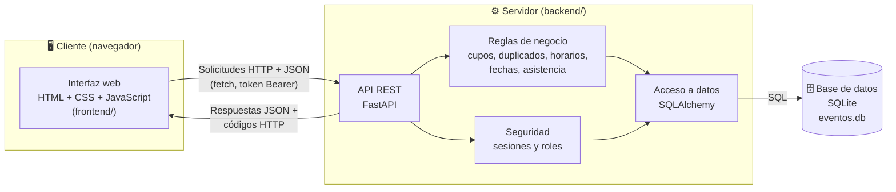
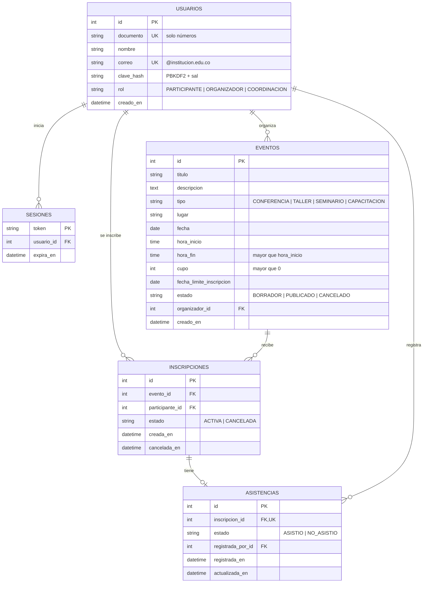
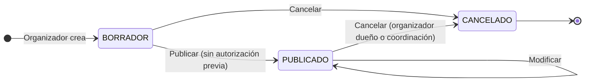
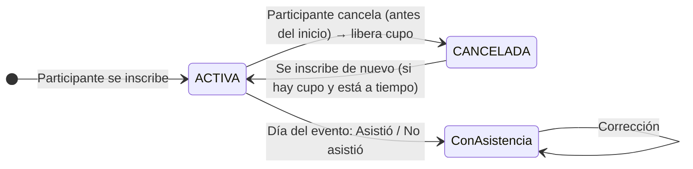
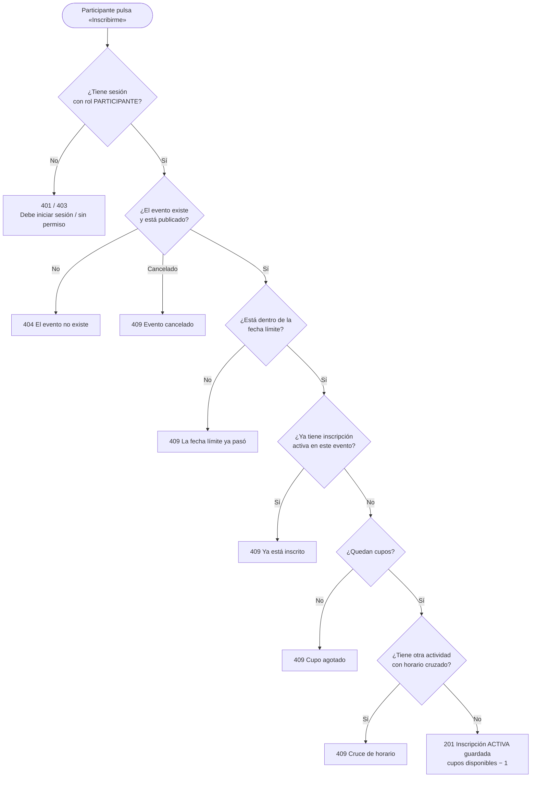
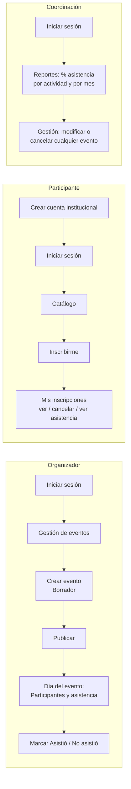

# Diseño de la aplicación y de los servicios web

Este documento explica **cómo** está construida la solución y por qué. Cada decisión se relaciona con los requisitos de [requisitos.md](requisitos.md).

---

## 1. Arquitectura cliente-servidor



| Componente | Responsabilidad | Carpeta |
|---|---|---|
| Interfaz web | Mostrar información, recibir acciones, mostrar errores; menú según rol. | `frontend/` |
| API REST | Recibir solicitudes HTTP, validar datos y responder con JSON y códigos HTTP. | `backend/app/routers/` |
| Seguridad | Cifrar contraseñas, crear/validar sesiones, verificar roles. | `backend/app/security.py` |
| Reglas de negocio | Cupos, duplicados, cruces de horario, fechas límite, asistencia. | `backend/app/routers/*.py` |
| Validación | Formatos, longitudes, rangos, coherencia de fechas y horas. | `backend/app/schemas.py` |
| Persistencia | Tablas, llaves y restricciones. | `backend/app/models.py`, `database.py` |

El mismo servidor entrega la interfaz web (archivos estáticos) y la API, por lo que **solo hay que ejecutar un programa**.

### Tecnologías y justificación

| Tecnología | Uso | Por qué |
|---|---|---|
| Python 3.10+ | Lenguaje del backend | Sintaxis clara y conocida por el equipo. |
| FastAPI | Framework backend / API REST | Valida datos automáticamente y genera la **documentación interactiva** (`/docs`) usada para probar los endpoints. |
| SQLAlchemy 2 | Acceso a la base de datos | Define tablas, relaciones y restricciones en código; permite cambiar de motor sin reescribir. |
| SQLite | Sistema de base de datos relacional | No requiere instalar un servidor; un solo archivo; soporta llaves foráneas y restricciones. |
| HTML, CSS y JavaScript (sin framework) | Frontend | No requiere compilación ni Node.js; usa `fetch` para consumir la API, lo que deja visible la integración cliente-servidor. |
| Git y GitHub | Control de versiones | Ramas, commits y pull requests revisados entre integrantes. |

---

## 2. Modelo de datos



### Restricciones que protegen la consistencia

| Restricción | Tabla | Qué evita |
|---|---|---|
| `UNIQUE(evento_id, participante_id)` | inscripciones | Inscripciones duplicadas (RN-05), incluso si se envían dos solicitudes. |
| `UNIQUE(inscripcion_id)` | asistencias | Dos registros de asistencia para la misma inscripción. |
| `UNIQUE(correo)`, `UNIQUE(documento)` | usuarios | Cuentas repetidas de la misma persona. |
| `CHECK(cupo > 0)`, `CHECK(hora_fin > hora_inicio)` | eventos | Eventos con datos imposibles. |
| `CHECK(estado IN ...)` | todas | Estados no definidos. |
| Llaves foráneas activadas (`PRAGMA foreign_keys=ON`) | todas | Registros huérfanos. |

**Decisión:** la asistencia se guarda ligada a la **inscripción** y no directamente al participante. Así, por diseño, es imposible registrar asistencia de alguien no inscrito (RN-11), y se conserva la relación actividad ↔ participante ↔ asistencia (CA-05).

**Decisión:** los cupos disponibles **no se guardan**; se calculan como `cupo − inscripciones ACTIVAS`. Así nunca quedan desactualizados.

---

## 3. Estados





---

## 4. Reglas de inscripción (orden en que se verifican)



---

## 5. Recorridos de los actores



### Pantallas (prototipos implementados)

| Pantalla | Archivo | Actor | Contenido |
|---|---|---|---|
| Catálogo | `index.html` | Todos | Portada con cifras (eventos próximos, inscripciones abiertas, cupos libres); tarjetas en tema oscuro con un tono de gris distinto por tipo, fecha, lugar, barra de cupos (gris → ámbar → rojo al llenarse) e insignias visibles para todos: «Cupo agotado», «Últimos cupos», «Inscripciones cerradas», «Estás inscrito», «Es hoy». Filtro por tipo y eventos pasados; los cupos se actualizan solos al volver a la página y cada 20 s. |
| Acceso | `login.html` | Todos | Pestañas «Iniciar sesión» y «Crear cuenta». |
| Mis inscripciones | `mis-inscripciones.html` | Participante | Tabla con estado de inscripción, asistencia y botón «Cancelar». |
| Gestión de eventos | `gestion.html` | Organizador / Coordinación | Indicadores por estado, filtro (borradores, publicados, cancelados) y tabla de eventos con ocupación y acciones Editar, Publicar, Participantes y asistencia, Cancelar; formulario de evento. |
| Participantes y asistencia | `asistencia.html` | Organizador / Coordinación | Ficha del evento, indicadores (cupo, inscritos, asistieron, % de asistencia…) y lista con selector Asistió / No asistió que resalta el valor registrado. |
| Reportes | `reportes.html` | Coordinación | Indicadores generales, gráfica de % por mes, actividades con mejor asistencia y tabla por actividad con el % en colores (▲ ≥ 80 %, ● 50–79 %, ▼ < 50 %); filtro por fechas. |

Las capturas de cada pantalla están en [`evidencias/capturas/`](../evidencias/capturas/).

---

## 6. Especificación de la API REST

Base: `http://127.0.0.1:8000` · Formato: JSON · Autenticación: encabezado `Authorization: Bearer <token>` · Documentación interactiva: `/docs`

| Método | Ruta | Quién | Descripción | Respuestas | RF |
|---|---|---|---|---|---|
| POST | `/api/auth/registro` | Público | Crear cuenta de participante | 201, 409, 422 | RF-01 |
| POST | `/api/auth/login` | Público | Iniciar sesión (devuelve token) | 200, 401 | RF-02 |
| POST | `/api/auth/logout` | Con sesión | Cerrar sesión | 204, 401 | RF-02 |
| GET | `/api/auth/yo` | Con sesión | Datos del usuario actual | 200, 401 | RF-02 |
| GET | `/api/eventos` | Público | Catálogo (filtros `tipo`, `incluir_pasados`) | 200, 422 | RF-05 |
| GET | `/api/eventos/{id}` | Público | Detalle con cupos | 200, 404 | RF-05 |
| GET | `/api/gestion/eventos` | Organizador, Coordinación | Eventos propios (organizador) o todos (coordinación) | 200, 401, 403 | RF-03 |
| POST | `/api/eventos` | Organizador | Crear evento (Borrador) | 201, 400, 401, 403, 422 | RF-03 |
| PUT | `/api/eventos/{id}` | Dueño, Coordinación | Modificar evento | 200, 400, 403, 404, 409, 422 | RF-03 |
| PATCH | `/api/eventos/{id}/publicar` | Dueño, Coordinación | Publicar | 200, 400, 403, 404, 409 | RF-04 |
| PATCH | `/api/eventos/{id}/cancelar` | Dueño, Coordinación | Cancelar evento | 200, 403, 404, 409 | RF-15 |
| POST | `/api/eventos/{id}/inscripciones` | Participante | Inscribirse | 201, 401, 403, 404, 409 | RF-06, 08, 09, 10 |
| GET | `/api/inscripciones/mias` | Participante | Mis inscripciones con asistencia | 200, 401, 403 | RF-07 |
| PATCH | `/api/inscripciones/{id}/cancelar` | Participante dueño | Cancelar inscripción | 200, 403, 404, 409 | RF-07 |
| GET | `/api/eventos/{id}/participantes` | Dueño, Coordinación | Lista de inscritos con asistencia | 200, 403, 404 | RF-12 |
| PUT | `/api/eventos/{id}/asistencia/{inscripcion_id}` | Dueño, Coordinación | Registrar (201) o corregir (200) asistencia | 200, 201, 403, 404, 409, 422 | RF-11, RF-12 |
| GET | `/api/reportes/eventos` | Coordinación | Consolidado por actividad (`desde`, `hasta`) | 200, 400, 403 | RF-13 |
| GET | `/api/reportes/periodos` | Coordinación | Consolidado por mes (`desde`, `hasta`) | 200, 400, 403 | RF-14 |

**¿Por qué no hay `DELETE`?** Borrar eventos o inscripciones haría perder el historial que la coordinación necesita para sus reportes. Por eso se usan **cambios de estado** (`cancelar`) en lugar de eliminar. Solo se implementan las operaciones que el proceso justifica.

### Códigos de respuesta usados

| Código | Significado en esta API |
|---|---|
| 200 OK | Consulta o modificación correcta. |
| 201 Created | Se creó un registro (evento, cuenta, inscripción, asistencia). |
| 204 No Content | Sesión cerrada. |
| 400 Bad Request | Dato válido en formato pero no permitido (fecha pasada, rango de fechas invertido). |
| 401 Unauthorized | No inició sesión, token inválido/vencido o credenciales incorrectas. |
| 403 Forbidden | Tiene sesión pero su rol o propiedad no le permite la acción. |
| 404 Not Found | El recurso no existe (o es un borrador no público). |
| 409 Conflict | Se incumple una regla de negocio: cupo agotado, duplicado, cruce, fecha límite, evento cancelado… |
| 422 Unprocessable Entity | Datos con formato inválido (campos vacíos, cupo 0, horas incoherentes, correo no institucional). |
| 500 | Error inesperado: se responde un mensaje genérico, sin detalles internos. |

### Ejemplos

**Crear evento** — `POST /api/eventos`

```json
{
  "titulo": "Taller de pruebas de software",
  "descripcion": "Introducción a pruebas funcionales.",
  "tipo": "TALLER",
  "lugar": "Sala de cómputo 3",
  "fecha": "2026-12-05",
  "hora_inicio": "08:00",
  "hora_fin": "10:00",
  "cupo": 25,
  "fecha_limite_inscripcion": "2026-12-04"
}
```

Respuesta `201`:

```json
{ "id": 11, "titulo": "Taller de pruebas de software", "estado": "BORRADOR", "cupo": 25,
  "inscritos": 0, "cupos_disponibles": 25, "inscripciones_abiertas": false,
  "organizador": { "id": 2, "nombre": "Carlos Ruiz" }, "...": "..." }
```

**Inscripción con cupo agotado** — `POST /api/eventos/2/inscripciones` → `409`

```json
{ "detail": "El cupo del evento está agotado." }
```

**Datos inválidos** — `POST /api/eventos` con `cupo: 0` y `titulo: ""` → `422`

```json
{ "detail": "Datos inválidos",
  "errores": ["titulo: String should have at least 3 characters", "cupo: Input should be greater than 0"] }
```

**Registrar asistencia** — `PUT /api/eventos/1/asistencia/1` con `{"estado": "ASISTIO"}` → `201`

```json
{ "inscripcion_id": 1, "documento": "2000000001", "nombre": "Ana Torres",
  "estado_inscripcion": "ACTIVA", "asistencia": "ASISTIO", "asistencia_registrada_en": "2026-11-16T10:05:00" }
```

---

## 7. Reglas de negocio y control de acceso: dónde se aplican

| Regla | Dónde se aplica | Respaldo en base de datos |
|---|---|---|
| Solo correo institucional (RN-01) | `schemas.py` → `RegistroEntrada` | `UNIQUE(correo)` |
| Fechas/horas coherentes (RN-16) | `schemas.py` → `EventoEntrada` | `CHECK(hora_fin > hora_inicio)` |
| Fecha límite, cupo, duplicado, cruce (RN-03 a RN-06) | `routers/inscripciones.py` → `inscribirse` | `UNIQUE(evento_id, participante_id)` |
| Cancelación y liberación de cupo (RN-07) | `routers/inscripciones.py` → `cancelar_inscripcion` | Cupo calculado (no almacenado) |
| Asistencia el día del evento, solo inscritos, corrección (RN-08 a RN-11) | `routers/asistencia.py` | `UNIQUE(inscripcion_id)` en asistencias |
| Cupo ≥ inscritos (RN-12) | `routers/eventos.py` → `modificar_evento` | `CHECK(cupo > 0)` |
| Organizador solo lo suyo; coordinación todo (RN-13, RN-14) | `routers/eventos.py` → `verificar_permiso_gestion` | — |
| Roles por endpoint | `security.py` → `requiere_rol(...)` | — |

### Matriz de permisos

| Acción | Visitante | Participante | Organizador | Coordinación |
|---|:-:|:-:|:-:|:-:|
| Ver catálogo y detalle | ✅ | ✅ | ✅ | ✅ |
| Crear cuenta | ✅ | — | — | — |
| Inscribirse / cancelar inscripción | ❌ 401 | ✅ | ❌ 403 | ❌ 403 |
| Crear evento | ❌ 401 | ❌ 403 | ✅ | ❌ 403 |
| Modificar / publicar / cancelar evento | ❌ 401 | ❌ 403 | ✅ solo propios | ✅ todos |
| Ver inscritos y registrar asistencia | ❌ 401 | ❌ 403 | ✅ solo propios | ✅ todos |
| Reportes consolidados | ❌ 401 | ❌ 403 | ❌ 403 | ✅ |

La interfaz oculta las opciones que el rol no tiene, pero **la protección real está en el servidor**: aunque alguien envíe la solicitud directamente (por ejemplo desde `/docs`), la API la rechaza.

---

## 8. Organización del código

```text
backend/app/
  main.py          Arranque: crea tablas, registra servicios, sirve el frontend, maneja errores
  config.py        Configuración leída de variables de entorno (.env)
  database.py      Conexión a la base de datos
  models.py        Tablas y restricciones
  schemas.py       Validación de datos de entrada y formato de salida
  security.py      Contraseñas, sesiones y roles
  seed.py          Datos ficticios de demostración
  routers/         Un archivo por recurso de la API (auth, eventos, inscripciones, asistencia, reportes)
frontend/          Páginas HTML, estilos y funciones comunes (js/api.js)
pruebas/           Script reproducible de pruebas funcionales
```

Se organizó **por responsabilidad**: cada archivo de `routers/` agrupa los servicios de un recurso con sus reglas, y `main.py` los registra automáticamente. Así cada integrante pudo trabajar en archivos distintos sin conflictos.
